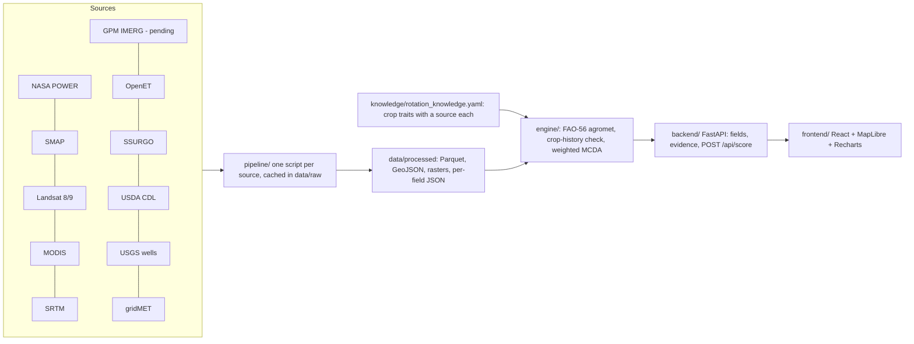

# Field Shift: Rotation Scenario Explorer

A farmer-centred decision-support tool for the 2026 NASA Space Apps Challenge,
**"Field Shift: Adapting Farms with NASA Data"**.

Pick a field (or draw one), see what NASA Earth observations and local soil data say
about it, set your own priorities, and compare five crop rotations, the existing one
included. Every rotation comes with why it was suggested, the evidence, the benefits,
the information gaps, the risks and a checklist to take to a local expert.

> **It compares options. It never says "plant crop X".** It supports, and does not
> replace, farmer judgment and local agricultural expertise.

Pilot area: **Diamond Valley, Eureka County, Nevada**: irrigated alfalfa on centre
pivots at about 1,800 m, in the basin that became Nevada's first Critical Management
Area because groundwater pumping has exceeded recharge for decades.

## Status at a glance

| | |
| :-- | :-- |
| App | Works: `python tasks.py dev`, then open http://localhost:5180 |
| Fields | 14 real pivots, outlines detected from Landsat (93 pivots found in the pilot box) |
| Data | Real downloads only. **No demo, sample or simulated data anywhere.** |
| Tests | 47 passing (`python tasks.py test`) |
| Needs your action | **GPM IMERG rainfall is not loaded**: the Earthdata account behind the token has not accepted the GES DISC data-use agreement. Exact step in [DATA_LOG.md](DATA_LOG.md) and below. The app runs without it and says so. |

## The problem

Choosing what to rotate into is hard because the answer depends on the field and on the
farmer. A crop that rests the soil may use too much water, need a combine nobody owns,
have no buyer, or die in a June frost. Farmers already know their fields; what they
often lack is a quick way to see the long record (weather, water use, greenness, soil,
groundwater) side by side with the trade-offs of each option, with the uncertainty
stated honestly.

## What the tool does

| Challenge asks for | What the app shows |
| :-- | :-- |
| Temperature, heat stress | Yearly mean temperature and days above 32 °C, 1991-2025, with a trend test |
| Rainfall, extreme precipitation | Yearly rain, heavy-rain days, monthly normals |
| Soil moisture | SMAP monthly anomaly (drier or wetter than normal for that month), 2015-2025 |
| Evaporation | OpenET field-scale actual ET with the model spread, reference ET, water balance |
| Frost risk | Frost-free season every year, and in how many years it was long enough for each crop |
| Vegetation stress | Landsat NDVI by month (2018-2025), MODIS peak greenness (2001-2025) |
| Long-term water trends | USGS groundwater levels in wells near the field, back to the 1960s |
| When fields are bare | A month-by-month calendar of low green cover against the months of highest wind and rain risk |
| When the crop is vulnerable | A stress calendar combining heat, frost, water gap, greenness dips and dry soil |
| Local soil information | SSURGO texture, organic matter, salinity, pH, wind erodibility, water-holding capacity |
| Compare at least three rotations incl. the existing one | Five: the existing rotation (read from the crop history) plus four alternatives |
| Why, evidence, benefits, gaps, risks | On every rotation card, each "why" linked to an evidence panel |
| Farmer priorities and constraints | Eight priority sliders; water available, equipment and market limits |
| Scenario sliders | Warmer by 0-4 °C and rain ±40 %: water demand, hot days and frost dates are recomputed and the rotations re-scored |
| Explain the science; satellite vs ground | Plain-language guide (ET, NDVI, soil-moisture anomaly, frost risk, water balance, satellite vs ground, confidence) |
| Explain uncertainty | A confidence level on every score and every rotation, with reasons; model spread on ET; doubtful crop-map years flagged |
| Supports, not replaces, local expertise | Stated at the top of every screen, in every result, and backed by a "check with a local expert" checklist |

Also: map layers (summer greenness by year, crop map by year, low-cover months, slope,
soil map units, wells), fields coloured by an indicator, a table view of every chart,
and a phone layout.

## Run it

Requirements: Python 3.10+ and Node.js 18+. `make` is optional.

```bash
python tasks.py setup    # or: make setup   (venv, Python and Node dependencies)
python tasks.py dev      # or: make dev     (API on :8360, app on :5180)
```

The processed data for the pilot is committed, so the app runs straight after `setup`.
To rebuild the data from the sources:

```bash
cp .env.example .env     # then add your own credentials
python tasks.py check    # tests each service; prints no secrets
python tasks.py data     # or: make data    (cached: a re-run fetches only what is missing)
python tasks.py test     # or: make test
```

`python tasks.py serve` builds the frontend and serves app and API together on :8360.
A single step can be re-run with `python tasks.py data imerg indicators datalog`.

### Credentials

`.env` (git-ignored) holds `EARTHDATA_TOKEN`, `OPENET_API_KEY` and `GEE_PROJECT_ID`. They
are read with python-dotenv, sent only to the service they belong to, and never printed
or logged. Rotate them after the event if they were ever shared in a chat.

### Action needed: GPM IMERG

GES DISC answers `HTTP 403 EULA Acceptance Failure` for the token's account.

1. Sign in at https://urs.earthdata.nasa.gov **with the account that issued the token**.
2. Open https://urs.earthdata.nasa.gov/approve_app?client_id=e2WVk8Pw6weeLUKZYOxvTQ and
   approve **NASA GESDISC DATA ARCHIVE** (Applications > Authorized Apps > Approve More
   Applications). No new token is needed.
3. Run `python tasks.py data imerg indicators datalog`.

Until then rainfall comes from NASA POWER corrected to gridMET, and the app marks IMERG
as "not loaded" on every field. The IMERG reader (`pipeline/s02_imerg.py`) could not be
exercised past the authorisation check, so treat its first real run as a test.

Earth Engine is **not required**: `earthengine authenticate` was never run on the build
machine, so Landsat is read from Microsoft Planetary Computer (the same Landsat
Collection 2 Level-2 scenes).

## Architecture



```
pipeline/   s00_fields ... s30_overlays, run_all.py, data_log.py, check_access.py
data/       raw/ (cache, git-ignored)   processed/ (what the app reads)
knowledge/  rotation_knowledge.yaml, glossary.json
engine/     agromet.py climate.py history.py context.py scoring.py knowledge.py
backend/    main.py custom.py
frontend/   src/App.tsx, components/{MapView,FieldSummary,Priorities,Strategies,Evidence,Modals}.tsx
tests/      agromet, processing, scoring, API
```

The live app makes no calls to any data provider: it reads `data/processed` only. (The
basemap tiles are the one thing fetched from the internet while it runs.)

### Harmonisation

Everything is reduced to **field polygon x month**, plus annual and growing-season
summaries, as the research report recommends:

| Native data | How it reaches the field |
| :-- | :-- |
| Landsat 30 m, CDL 30 m, SRTM 30 m | Area-weighted zonal statistics (pixel weight = share of the pixel inside the field) |
| MODIS 250 m | Same, on the sinusoidal grid; only each year's peak is used |
| OpenET 30 m | Field-polygon mean from the OpenET API |
| SMAP 9 km, POWER ~50 km, gridMET 4 km | The grid cell containing the field; anomaly against that cell's own calendar month |
| SSURGO map units | Component-percent and thickness-weighted (0-30 cm), then area-weighted over the field |
| USGS wells | Wells within 12 km, yearly median depth, pumping-affected readings excluded |

### Scoring

`Score(rotation) = sum of weight x score`, over eight priorities, with the farmer's
sliders normalised to sum to 1. Rule-based agronomy plus statistical climatology; no
yield model and no machine learning. Every score opens to show its formula, inputs,
sources and confidence. Full method and every crop value with its source:
[ROTATION_KNOWLEDGE.md](ROTATION_KNOWLEDGE.md).

## Datasets

Details, date ranges, sanity checks and credits for each: [DATA_LOG.md](DATA_LOG.md).

| Tier | Dataset | Status | Used for |
| :-- | :-- | :-- | :-- |
| MUST | NASA POWER | Loaded: 12,784 days, 1991-2025 | Reference ET, heat, frost, wind, rain, trends, scenarios |
| MUST | GPM IMERG | **Not loaded: needs the GES DISC agreement** | Rainfall, heavy-rain days |
| MUST | SMAP SPL3SMP_E | Loaded: 2,857 retrieval days, 2015-2025 | Soil-moisture anomaly |
| MUST | SSURGO | Loaded: 30 map units | Soil properties, erodibility, salinity |
| MUST | USDA CDL | Loaded: 2008-2025 | Crop history, existing rotation |
| STRONG | Landsat 8/9 | Loaded: 461 overpasses, 4,178 clear field observations | Field outlines, NDVI, low-cover months, crop-map check |
| STRONG | OpenET | Loaded: 14 fields, 2016-2025 (47 of the 100 monthly API requests used) | Actual ET, model spread, anchoring the water estimate |
| OPTIONAL | SRTM | Loaded | Field tilt and elevation |
| OPTIONAL | MODIS MOD13Q1 | Loaded: 575 composites, 2001-2025 | 25-year peak greenness |
| OPTIONAL | USGS NWIS | Loaded: 310 wells, 3,425 measurements | Long-term water trend |
| OPTIONAL | gridMET | Loaded: 1991-2025 | Bias-correcting NASA POWER to the valley floor |
| SKIP | ECOSTRESS | Not used | Irregular ISS overpasses and revisit, heavy swath preprocessing; OpenET already gives field ET |
| SKIP | GRACE / GRACE-FO | Not used | ~300 km footprint, far larger than the valley; wells answer the question directly |
| SKIP | GEDI | Not used | Forest-structure lidar; not meaningful over hay |
| OPTIONAL | PRISM, NLDAS/GLDAS, ERA5, Sentinel-2, NLCD, NAIP, LANDFIRE, NASS QuickStats, AMS, GAEZ, CoCoRaHS | Not used | Reasons listed one by one in DATA_LOG.md |

Two routes had to change during the build, both recorded in the log: CropScape timed
out, so the crop map comes from USDA's CroplandCROS image service; and OpenET's
field-boundary endpoint returned HTTP 400 for every request (even its own documented
example), so field outlines are detected from Landsat instead.

## What the data showed

These came out of the pipeline, not out of assumptions:

- **A weather grid alone gets frost wrong here.** NASA POWER's ~50 km cell puts the
  frost-free season at about 134 days. Corrected with station-informed gridMET it is
  81-93 days: valley-floor nights run about 4-5 °C colder. That is the difference
  between teff looking safe and teff fitting in only about 70 % of years on the colder
  fields.
- **Real fields use less than the textbook says.** In their own alfalfa years, 13 of the
  14 pilot fields used 68-86 % of the FAO-56 full-irrigation figure according to OpenET.
  Each field's water estimate is scaled by its own ratio (the 14th has too few clean
  alfalfa years, so its estimate is left unscaled and marked low confidence).
- **Rotation alone saves a modest amount of water.** The thriftiest rotation here needs
  about 17 % less irrigation than continuous alfalfa. Double-cropped break years save
  almost nothing. The tool says so instead of promising more.
- **Groundwater near the pivots is falling.** Most long-record USGS wells within 12 km
  of each pilot field have been deepening since 1990 (for example 4 of 4 near Field 3,
  at a median 4.5 m per decade; the median rate around the fields ranges from 0.6 to
  5.0 m per decade). Across all 18 long-record wells in the wider area, 10 are
  deepening significantly and 3 are rising.
- **Hot days are increasing**, by roughly 5 to 9 more days above 32 °C per decade since
  1991, depending on the dataset (gridMET or corrected NASA POWER) and the grid cell;
  the trend is statistically significant in both.
- **The crop map is sometimes wrong.** It labels some green, irrigated pivots
  "shrubland", "evergreen forest" or "wetland" in single years. Landsat greenness is
  used as a second opinion and those years are flagged for the farmer to correct.

## Limitations

- One pilot valley, 14 fields. The crop calendars and class scores are written for
  Great Basin irrigated forage and are **not calibrated locally**.
- Field outlines are the largest circle inside each irrigated footprint on Landsat, not
  surveyed boundaries.
- No prices, yields, costs, pests, diseases, herbicide history, irrigation system or
  water rights are known to the tool. The forage/income score is a rough ordering from
  class scores and is always marked low confidence.
- Water figures are crop demand, not pumped water, and rest on gridded weather and
  tabulated crop coefficients. Teff and safflower water use at this elevation is poorly
  documented.
- SMAP sees the top ~5 cm over 9 km pixels that are mostly desert; it describes the
  valley, not a pivot. NDVI shows green cover, not soil health.
- The what-if sliders shift the historical weather record uniformly. They are a
  sensitivity test, not a climate projection.
- The app's basemap needs an internet connection.
- No farmer or agronomist has reviewed the rotation library yet. That is the next step
  before anyone acts on it.

## Tests

`python tasks.py test` runs 47 tests: FAO-56 reference ET against the worked examples in
the FAO paper, effective rain, frost and trend functions, area-weighted zonal
statistics, grid indexing, crop-history interpretation, knowledge-base validation, each
scoring criterion, constraints, scenarios, the wording rule (the output never tells the
farmer what to plant), and the API against the real processed data including a drawn
field.

## Credits

Data: NASA POWER (NASA LaRC); SMAP (NASA NSIDC DAAC); Landsat 8/9 (USGS and NASA, via
Microsoft Planetary Computer); MODIS MOD13Q1 (NASA LP DAAC, via ORNL DAAC); SRTM (NASA
JPL, LP DAAC); USDA NRCS SSURGO; USDA NASS Cropland Data Layer; OpenET; USGS National
Water Information System; gridMET (Abatzoglou 2013). Basemap: Sentinel-2 cloudless by
EOX (contains modified Copernicus Sentinel data 2016) and OpenStreetMap contributors.
Methods: FAO Irrigation and Drainage Papers 56 and 33; USDA NRCS National Engineering
Handbook Part 623. Full citations in DATA_LOG.md and ROTATION_KNOWLEDGE.md.

NASA does not endorse this tool or any non-U.S. Government entity.

See also: [PLAN.md](PLAN.md) · [DATA_LOG.md](DATA_LOG.md) ·
[ROTATION_KNOWLEDGE.md](ROTATION_KNOWLEDGE.md) · [DEMO_SCRIPT.md](DEMO_SCRIPT.md)
